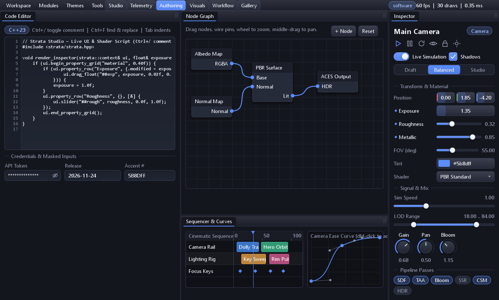
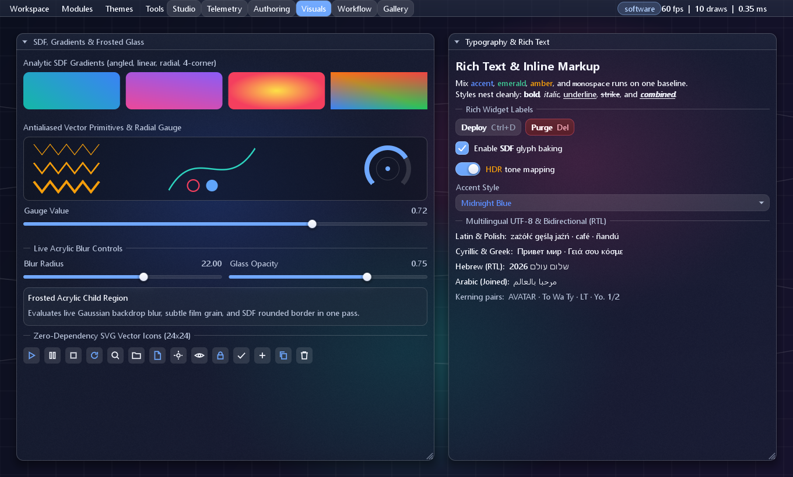
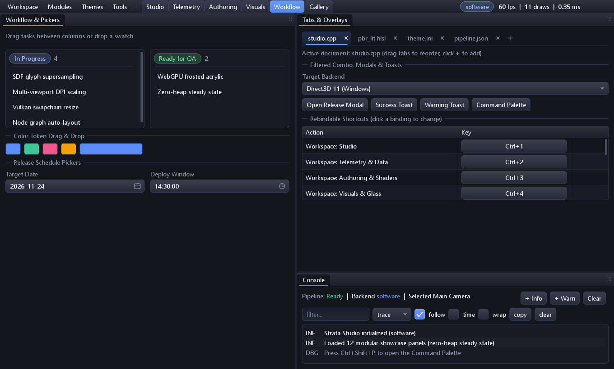
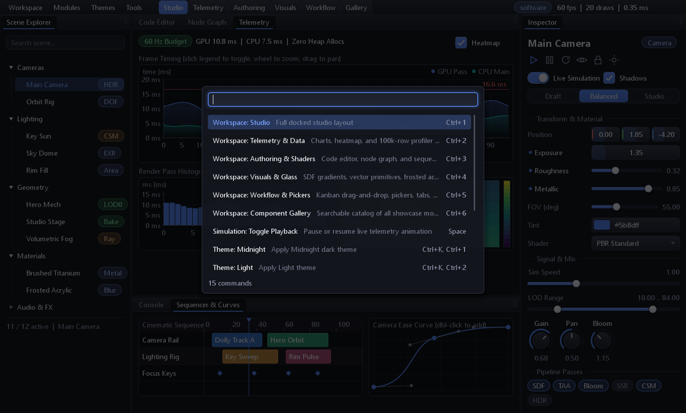

# strata

A fast, zero-allocation-in-steady-state immediate-mode UI framework in modern C++ with **Direct3D 11**, **Direct3D 12**, **OpenGL 3.3+**, **Vulkan**, **WebGPU**, **Metal**, and **CPU software** backends - plus a C99 API, Rust bindings, multi-viewport support, and in-game / VR overlays.

> **Work in progress:** the API and core layout are actively evolving and may change between commits.

[**Features**](#why-strata) · [**Screenshots**](#screenshots) · [**Backends**](#backends--platforms) · [**Quickstart**](#quickstart) · [**Build**](#build--test) · [**Docs**](#documentation)


## Why strata?

- **Zero heap traffic in steady state** - geometry buffers use reserved virtual memory (`vmem_array`) committed in 64 KiB chunks; unchanged frames hash identical and let hosts sleep (`ui.can_idle()`).
- **Analytic SDF rendering & frosted glass** - one quad per rounded panel evaluates per-corner radii, linear/radial gradients, borders, soft shadows, and live backdrop blur directly in the shader.
- **Universal graphics & platform reach** - C++20 concept-driven backends (`D3D11`, `D3D12`, `OpenGL 3.3+`, `Vulkan`, `WebGPU/WASM`, `Metal`, `CPU software`, `Null`) with Win32, GLFW, and SDL3 platform adapters plus a ready-made multi-backend `strata::app` host.
- **Built-in pro-tool widgets** - docking & tear-off multi-viewport OS windows, syntax-highlighted code editor (`Ctrl+/`, find/replace), node graph editor, interactive charts & heatmaps, timeline/sequencer, Bezier curve editor, property inspector grid, rich text, and 100k-row virtualized tables.
- **Sharp text & vector icons everywhere** - optional single-channel SDF glyph baking (`font_config::sdf`), full UTF-8/RTL/IME support, and a built-in zero-dependency SVG path engine (`strata/svg.hpp`) with cross-platform vector UI icons.
- **C99 & Rust ready, lean static footprint** - no exceptions, no RTTI, static library only, `<windows.h>` kept out of public headers, and official Rust crates in [`bindings/rust/`](bindings/rust/README.md).

## Screenshots

Captured from the shared modular showcase (`strata_sandbox --scene NAME --shot FILE` — identical UI runs live in the browser via WebGPU in [`web/`](web/)).

| | |
|---|---|
| <br>**Telemetry & Data** - interactive multi-series charts, budget reference lines, histograms, 2D heatmaps, and 100k-row virtualized tables | <br>**Authoring & Shaders** - syntax-highlighted code editor (`Ctrl+/`, find/replace), PBR node graph, timeline sequencer, and Bezier curve editor |
| <br>**Visuals & Frosted Glass** - analytic SDF gradients, antialiased vector paths, live acrylic backdrop blur (`glass` theme), SVG icons, and rich UTF-8/RTL text | <br>**Workflow & Pickers** - Kanban drag & drop, color token drop targets, date/time pickers, closable/reorderable tabs, and rebindable shortcuts |
| <br>**Command Palette** - `Ctrl+Shift+P` fuzzy action search with multi-key chords over the docked studio workspace | <br>**Component Gallery** - searchable, categorized module browser; new feature modules drop into `showcase/modules/` and appear on desktop and WebGPU automatically |

## Backends & platforms

| Category | Supported |
|---|---|
| **GPU Renderers** | Direct3D 11 (`d3d11_renderer`), Direct3D 12 (`d3d12_renderer`), OpenGL 3.3+ Core (`gl_renderer`), Vulkan 1.0+ (`vulkan_renderer`), WebGPU (`wgpu_renderer` - Dawn / wgpu / WASM), Metal (`metal_renderer` - macOS / iOS) |
| **Headless Renderers** | CPU Software (`software_renderer` with partial damage-rect redraw), Null (`null_renderer` validator) |
| **Platform Adapters** | Win32 (`win32_platform` + IME + file drop), GLFW (`glfw_platform`), SDL3 (`sdl3_platform`), ready-made `strata::app` (D3D11 / OpenGL / Vulkan) |
| **Language Bindings** | C++23/latest native, C99 (`strata/strata_c.h`), Rust (`bindings/rust/` - `strata-sys` + `strata`) |
| **Overlays** | Direct3D 11/12 (DXGI vtable), OpenGL (`SwapBuffers` IAT), Vulkan (`VK_LAYER_strata_overlay`), OpenXR & OpenVR |

All shaders are compiled at build time (DXBC / SPIR-V) or embedded as WGSL / MSL / GLSL - zero runtime shader compiler dependencies.

## Quickstart

```cpp
auto ui = strata::context::create().value();
strata::win32_platform platform;  platform.attach(hwnd); // or glfw_platform / sdl3_platform

strata::d3d11_renderer renderer;  // or d3d12_renderer / gl_renderer / vulkan_renderer / wgpu_renderer
renderer.create(device, device_context, ui.font());
ui.release_font_pixels();

// per frame
if (strata::run_frame(ui, platform, [&](strata::context& ui) {
        if (auto w = ui.window("Inspector", {24, 24}, 320.0f)) {
            ui.textf("{:.1f} fps", fps);
            ui.checkbox("Enabled", enabled);
            ui.slider("Speed", speed, 0.0f, 4.0f);
            if (ui.button("Reset")) { speed = 1.0f; }
        }
    })) {
    renderer.render(ui.render_data());
}
```

Or pull `strata` into any CMake project with `FetchContent` (also packaged as a vcpkg overlay port in [`packaging/vcpkg/`](packaging/vcpkg/vcpkg.json)):

```cmake
include(FetchContent)
FetchContent_Declare(strata GIT_REPOSITORY https://github.com/<org>/strata.git GIT_TAG main)
set(STRATA_MINIMAL ON CACHE BOOL "" FORCE) # core + software/null only; enable STRATA_BUILD_OPENGL / VULKAN / DX11 as needed
FetchContent_MakeAvailable(strata)
target_link_libraries(my_app PRIVATE strata::strata)
```

## Build & test

Requires CMake 4.3+ and a C++23/latest compiler (MSVC, `clang-cl`, GCC, Clang, or Emscripten).

| Platform / Tool | Command |
|---|---|
| **Windows (MSVC / `clang-cl`)** | `.\build_vs.cmd x64-release` (fast iteration: `x64-dev`; Clang: `x64-clang-release`) |
| **Visual Studio** | `cmake --preset vs2022` and open `build/vs2022/strata.sln` |
| **Linux (headless + OpenGL)** | `cmake -S . -B build/linux -G Ninja -DCMAKE_BUILD_TYPE=Release && cmake --build build/linux` |
| **WebAssembly (Emscripten)** | `emcmake cmake --preset wasm-release && cmake --build build/wasm-release` (serves `build/wasm-release/web/index.html`; auto-deployed to GitHub Pages by `.github/workflows/pages.yml`) |
| **Headless tests** | `ctest --test-dir build/x64-release -LE gpu --output-on-failure` |

Key CMake options (`-D<OPT>=ON|OFF`):

- **Backends:** `STRATA_BUILD_DX11`, `STRATA_BUILD_DX12`, `STRATA_BUILD_OPENGL`, `STRATA_BUILD_VULKAN`, `STRATA_BUILD_WEBGPU`, `STRATA_BUILD_METAL`, `STRATA_BUILD_OPENXR`, `STRATA_BUILD_OPENVR`
- **Components:** `STRATA_MINIMAL`, `STRATA_BUILD_SANDBOX`, `STRATA_BUILD_WEB_DEMO`, `STRATA_BUILD_OVERLAY`, `STRATA_BUILD_TESTS`, `STRATA_BUILD_FUZZERS`
- **Build:** `STRATA_STATIC_CRT`, `STRATA_LTO`, `STRATA_FAST_MATH`, `STRATA_AVX2`, `STRATA_WERROR`, `STRATA_PCH`, `STRATA_DIAGNOSTICS`, `STRATA_ASAN`

## Documentation

| Guide | Covers |
|---|---|
| **[Widgets & Layout](docs/widgets.md)** | Controls, inputs, tables, trees, docking, multi-viewport, timeline/sequencer, Bezier curves, property grid, charts/heatmaps, code editor, rich text, node editor |
| **[Architecture & Styling](docs/architecture.md)** | Zero-heap design, SDF shapes & acrylic blur, DPI & SDF fonts, SVG path icons, themes & hot-reload, keybinds/config, idling, diagnostics, footprint |
| **[Backends, Platforms & Bindings](docs/backends-and-bindings.md)** | D3D11/12, OpenGL, Vulkan, WebGPU, Metal, software partial redraw, Win32/GLFW/SDL3, `strata::app`, C99 API, Rust bindings, sandbox CLI |
| **[In-Game & VR/XR Overlays](docs/overlays.md)** | D3D11/12 DXGI hook, OpenGL IAT hook, Vulkan explicit layer (`VK_LAYER_strata_overlay`), runtime scaling, OpenXR / OpenVR |

## Repository layout

```text
strata/     static library (strata::strata) + optional app host (strata::app)
showcase/   shared modular showcase library (strata_showcase: 12 feature panels, desktop + web)
sandbox/    desktop showcase host & test harness (D3D11, D3D12, OpenGL, Vulkan, software, VR)
web/        browser WebGPU + WASM live showcase (shares strata_showcase, with CPU software fallback)
overlay/    in-game overlays (DXGI D3D11/12, OpenGL IAT, Vulkan explicit layer, injector)
bindings/   official language bindings (Rust workspace: strata-sys + strata)
packaging/  vcpkg overlay port
docs/       detailed documentation and screenshots
cmake/      options, compiler flags, HLSL / SPIR-V embedding, package config
tests/      self-tests, C API test, offscreen GPU tests, fuzz targets
```

## License

Licensed under the [MIT License](LICENSE).

## Acknowledgments

Portions of this project's documentation and code were developed with assistance from Claude (Anthropic) and Gemini (Google). Design decisions, architecture, and direction are the author's own.
